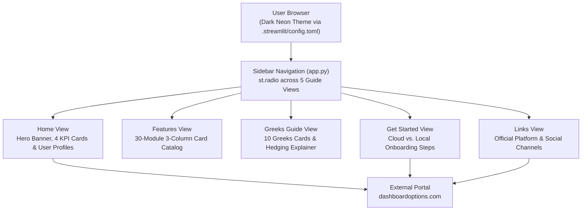

<h1 align="center">📊 Dashboard Options — Interactive Platform Guide</h1>

<p align="center">
  <strong>An interactive, dark-themed Streamlit documentation and showcase portal for <a href="https://dashboardoptions.com">Dashboard Options</a> — detailing 30+ institutional-grade options analytics pages, 10 real-time primary and higher-order Greeks, and local/cloud onboarding workflows.</strong>
</p>

<p align="center">
  <a href="#-executive-overview"><b>Overview</b></a> •
  <a href="#-interactive-pages"><b>Pages</b></a> •
  <a href="#-platform-capabilities-catalog"><b>30+ Capabilities</b></a> •
  <a href="#-greeks-reference-guide"><b>Greeks Guide</b></a> •
  <a href="#-application-architecture"><b>Architecture</b></a> •
  <a href="#-repository-structure"><b>Structure</b></a> •
  <a href="#-installation--usage"><b>Setup</b></a> •
  <a href="#-license"><b>License</b></a>
</p>

<p align="center">
  <a href="https://dashboardoptions.com"></a>
  
  = 1.32.0" />
  
</p>

<p align="center">
  
  
  
  <a href="https://x.com/DashboardOption"></a>
</p>

---

## 📋 Executive Overview

**`guide-dashboardoptions`** is a lightweight, single-entrypoint **Streamlit** web guide built for **[Dashboard Options](https://dashboardoptions.com)** — an open options analytics platform founded by **Khalid Naami**. It serves as a structured onboarding portal and visual feature directory for both active derivatives traders and quantitative researchers.

Rather than burying capabilities inside dense documentation, `app.py` renders a custom dark-mode UI (`#080808` canvas, `#00ff88` neon accents, `Inter` and `JetBrains Mono` typography configured via `.streamlit/config.toml`) that walks users through:

- **Who the platform serves**: Actionable intraday positioning (`GEX`, unusual flow, dealer hedging) for active traders, alongside volatility surfaces, CFTC Commitment of Traders (`COT`), and seasonality workflows for researchers.
- **What the platform measures**: A full catalog of **30 specialized analytics modules** spanning options chains, 1st/2nd/3rd-order Greek exposures, volatility term structures, macro liquidity, and maritime trade correlation.
- **How dealer flows work**: A dedicated educational guide explaining all **10 tracked Greeks** and how mechanical market-maker hedging around Gamma, Vanna, and Charm impacts spot price action.

---

## 🖥️ Interactive Pages

`app.py` organizes navigation into five radio-selected views inside a custom-styled sidebar:

| View | Purpose | Key UI Components in `app.py` |
|---|---|---|
| **Home** | Platform value proposition and KPI summary | Hero banner with direct CTAs (`dashboardoptions.com` & GitHub), 4 KPI metric cards (`30+` Analytics Pages, `10` Greeks Tracked, `100%` Free & Open, `8` Real-Time Data), and audience cards (*For Active Traders*, *For Researchers*). |
| **Features** | Complete module directory | 3-column responsive card grid documenting all **30 platform analytics pages** across derivatives flow, volatility, strategy construction, macroeconomics, and portfolio risk. |
| **Greeks Guide** | Derivatives sensitivity reference | 2-column card layout detailing all **10 Greeks** (`Delta`, `Gamma`, `Theta`, `Vega`, `Rho`, `Vanna`, `Charm`, `Vomma`, `Speed`, `Color`) plus an explainer panel on mechanical dealer delta-hedging flows. |
| **Get Started** | Access & onboarding guide | Side-by-side cards comparing browser access (`dashboardoptions.com`) vs. local execution, followed by a 5-step setup walkthrough. |
| **Links** | Ecosystem & community directory | Verified brand badges and direct links to Dashboard Options, `khalidnaami.com`, GitHub, X (`@DashboardOption`), LinkedIn, Instagram, Discord, Telegram, and YouTube. |

---

## 🧩 Platform Capabilities Catalog

The **Features** view in `app.py` documents all **30 analytics pages** of the Dashboard Options ecosystem:

| Category | Modules Covered | Analytical Focus |
|---|---|---|
| **Core Options & Orderflow** | `Options Dashboard`, `Options Flow`, `OI & Volume`, `Multi-Ticker View` | Real-time chains, unusual block trades, strike-level open interest/volume, and multi-symbol comparison. |
| **Greek Exposure Surfaces** | `GEX Surface`, `Exposure Heatmap`, `Delta Exposure`, `Gamma Exposure`, `Vanna Exposure`, `Charm Exposure`, `Vomma Exposure`, `Speed Exposure`, `Color Exposure` | Dealer hedging pressure across strikes and expirations from 1st-order (`Delta`) through 2nd-order (`Gamma`, `Vanna`, `Charm`, `Vomma`) and 3rd-order (`Speed`, `Color`) sensitivities. |
| **Volatility & Pricing** | `IV Surface`, `Volatility Calendar`, `Volatility Analysis`, `Implied Probabilities`, `Expected Move`, `Strategy Builder` | 3D implied volatility smile/skew, term structure, market-implied price distributions, expected moves, and multi-leg P&L modeling. |
| **Macro, Events & Sentiment** | `Market Sentiment`, `Earnings Intelligence`, `FOMC Meetings`, `COT Report`, `Macro Liquidity`, `Maritime Intelligence`, `Seasonality` | Aggregated options sentiment, earnings event pricing, Fed policy calendars, CFTC positioning, global liquidity, maritime trade correlation, and historical seasonality. |
| **Risk & News** | `Risk Analysis`, `Portfolio`, `Breaking News`, `Analysis` | Portfolio exposure tracking, scenario risk diagnostics, real-time financial news, and technical/fundamental toolkits. |

---

## 🧮 Greeks Reference Guide

The **Greeks Guide** view in `app.py` categorizes the **10 Black–Scholes–Merton sensitivities** tracked across the Dashboard Options platform:

| Order | Greek | Sensitivity | Analytical Role in Dealer Hedging |
|---|---|---|---|
| **1st Order** | **Delta ($\Delta$)** | $\frac{\partial V}{\partial S}$ | Option price sensitivity per `$1` spot move ($0$ to $1$ calls, $-1$ to $0$ puts); baseline directional exposure. |
| **1st Order** | **Theta ($\Theta$)** | $\frac{\partial V}{\partial t}$ | Daily option value decay due to time passage; holding cost for long option positions. |
| **1st Order** | **Vega ($\nu$)** | $\frac{\partial V}{\partial \sigma}$ | Option price change per `1%` shift in implied volatility (`IV`). |
| **1st Order** | **Rho ($\rho$)** | $\frac{\partial V}{\partial r}$ | Sensitivity to risk-free interest rate shifts. |
| **2nd Order** | **Gamma ($\Gamma$)** | $\frac{\partial^2 V}{\partial S^2}$ | Rate of change of Delta; high positive/negative Gamma forces market makers to hedge dynamically, creating price magnets or accelerators. |
| **2nd Order** | **Vanna** | $\frac{\partial^2 V}{\partial S \partial \sigma}$ | Cross-derivative measuring how Delta shifts when implied volatility expands or contracts. |
| **2nd Order** | **Charm** | $\frac{\partial^2 V}{\partial S \partial t}$ | Delta decay over time; drives mechanical dealer re-hedging flows approaching expiration (`0DTE` / OpEx). |
| **2nd Order** | **Vomma (Volga)** | $\frac{\partial^2 V}{\partial \sigma^2}$ | Volatility convexity measuring how Vega responds to `IV` changes. |
| **3rd Order** | **Speed** | $\frac{\partial^3 V}{\partial S^3}$ | Rate of change of Gamma with respect to underlying spot price movement. |
| **3rd Order** | **Color** | $\frac{\partial^3 V}{\partial S^2 \partial t}$ | Rate of change of Gamma over time, forecasting dealer Gamma decay into expiration. |

---

## 🏗️ Application Architecture



---

## 📂 Repository Structure

```text
guide-dashboardoptions/
├── .streamlit/
│   └── config.toml        # Streamlit dark theme (#080808 bg, #00ff88 primary) & headless server setting
├── .gitattributes         # Git line-ending normalization
├── LICENSE                # MIT License
├── README.md              # Project documentation
├── app.py                 # Main Streamlit application (5-page guide, custom CSS & HTML cards)
└── requirements.txt       # Python dependency specification (streamlit>=1.32.0)
```

---

## 🚀 Installation & Usage

### Prerequisites

- **Python**: `3.9+` recommended (compatible with `streamlit>=1.32.0`)
- **pip** (or `venv` for isolated environments)

### 1. Clone the Repository

```bash
git clone https://github.com/khalid-naami/guide-dashboardoptions.git
cd guide-dashboardoptions
```

### 2. Create a Virtual Environment & Install Dependencies

**Windows (PowerShell):**

```powershell
python -m venv .venv
.\.venv\Scripts\Activate.ps1
pip install -r requirements.txt
```

**macOS / Linux:**

```bash
python3 -m venv .venv
source .venv/bin/activate
pip install -r requirements.txt
```

### 3. Launch the Streamlit Guide

```bash
streamlit run app.py
```

The application opens locally at `http://localhost:8501` with `.streamlit/config.toml` dark theming automatically applied.

---

## 🌐 Ecosystem Links & Disclaimer

- **Live Platform**: [dashboardoptions.com](https://dashboardoptions.com)
- **Author Website**: [khalidnaami.com](https://khalidnaami.com)
- **Community**: [X (@DashboardOption)](https://x.com/DashboardOption) · [LinkedIn](https://www.linkedin.com/company/dashboard-options/) · [Discord](https://discord.gg/NRSzCYRzpJ) · [Telegram](https://t.me/dashboardoptions) · [YouTube](https://www.youtube.com/@DashboardOptions)

> **Disclaimer**: This repository is an informational and educational showcase for the Dashboard Options analytics suite. Nothing presented in the guide constitutes investment, trading, or financial advice.

---

## 📜 License

Released under the **MIT License**. See [LICENSE](LICENSE) for full terms.
